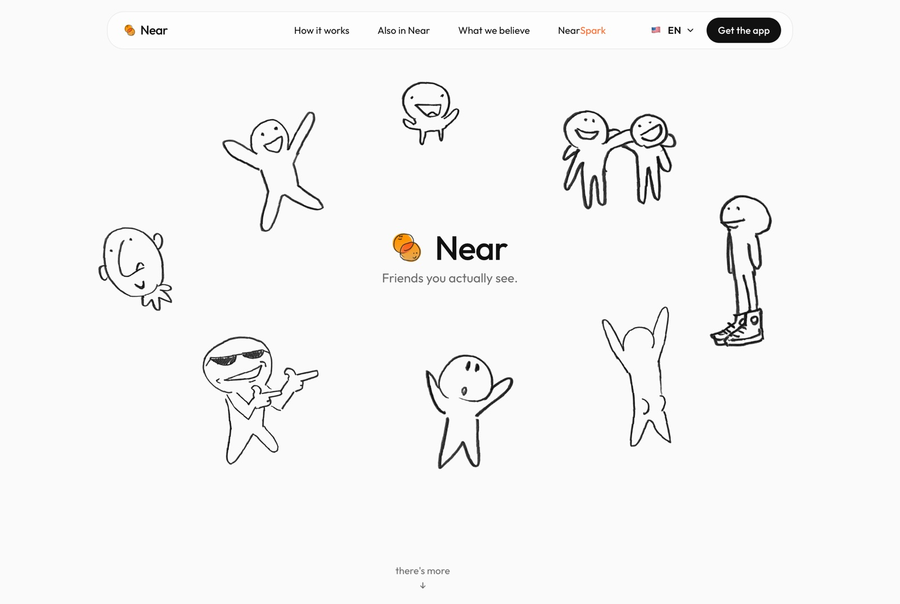

# Near website

The landing page for **Near**, an iOS social network for the friends you actually see. You can only add someone on Near while you're physically together, phone next to phone.

**Live:** [nearapp.social](https://nearapp.social) · The app is in TestFlight, App Store soon.



## What I built

- **A static Astro site in seven languages.** English, Portuguese, Spanish, French, German, Italian and Russian, each with its own URL, `hreflang` tags and a language switcher.
- **Hand-drawn art that "boils".** Every drawing wobbles like a hand-animated cartoon, using SVG turbulence filters swapped on a timer, with a separate set for hover. No video, no canvas.
- **A waitlist and contact form on Supabase.** Postgres tables with insert-only row-level security, plus Edge Functions that send the welcome email, handle signed unsubscribe links, and notify me of new messages.
- **Tiny vanilla scripts instead of a framework.** Reveal-on-scroll, the phone mockup, the roadmap and smooth scrolling are each a few dozen lines of TypeScript.
- **Legal pages** (privacy, terms), all localized.

Near's Bluetooth proximity engine is open source as [copresence-bluetooth-kit](https://github.com/gabrielcoffee/copresence-bluetooth-kit).

## Stack

| | |
|---|---|
| Site | Astro 7, Tailwind CSS 4, TypeScript |
| Scrolling | Lenis |
| Backend | Supabase (Postgres, Edge Functions) |
| Hosting | Vercel |

## Run locally

```bash
npm install
npm run dev       # http://localhost:4321
npm run build     # static output in dist/
npm run preview
```

## Project layout

- `src/config.ts` holds the App Store URL, Supabase keys, contact email and the list of locales.
- `src/i18n/*.ts` has one dictionary per language. To add one, copy `en.ts`, then register it in `config.ts`, `astro.config.mjs` and `src/i18n/index.ts`.
- `src/components/` has the page sections (`Hero`, `HowItWorks`, `Beliefs`, `Cta`) and UI pieces (`Header`, `Waitlist`, `ContactForm`, `PhoneMock`, `Drawing`).
- `src/scripts/` has the small client modules: `boil`, `reveal`, `header`, `phone`, `roadmap`, `lang`, `smooth`, `waitlist`, `contact`.
- `supabase/migrations/` defines the `waitlist` and `contact_messages` tables. `supabase/functions/` has the email Edge Functions.

### Drawings

Put new transparent PNGs in `drawings-src/` and normalize them:

```bash
node scripts/normalize-drawings.mjs
```

Then use one anywhere with `<Drawing name="file-name" size={160} />`. The boil filters live in `src/layouts/Base.astro`, and the frame rate in `src/scripts/boil.ts`.
